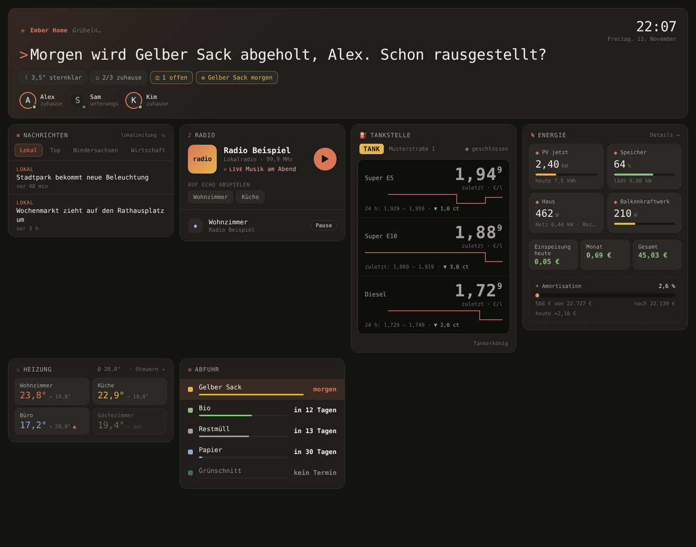

# ✻ Ember Terminal – Home Assistant Theme

Ein dunkles Home-Assistant-Theme im Terminal-Look: warmes Fast-Schwarz, Glut-Orange als Akzent, Monospace-Schrift (JetBrains Mono). Dazu passende Lovelace-Karten.

> Inspiriert vom Look moderner KI-Terminal-Tools wie Claude Code. Dies ist ein unabhängiges Community-Projekt und steht in keiner Verbindung zu Anthropic. „Claude“ und „Claude Code“ sind Marken von Anthropic.



## Inhalt

| Pfad | Was |
|---|---|
| `themes/ember_terminal.yaml` | Das Theme für die ganze Oberfläche: Seitenleiste, Kopfzeile, Einstellungen, Dialoge, Formulare, Diagramme, Energie, Mushroom |
| `dashboard/ember-cards.js` | Eigene Lovelace-Karten im gleichen Stil (Begrüßung, News, Radio, Tankstelle, Energie, Heizung, Abfuhr, Liste, Kopfzeile) |
| `hacs.json` | Damit sich das Theme über den Marketplace (früher HACS) installieren lässt |

## Farben

| Rolle | Farbe |
|---|---|
| Hintergrund | `#141413` |
| Karten | `#1f1e1d` |
| Rahmen | `#33312d` |
| Text | `#f0eee6` |
| Text gedämpft | `#a3a199` |
| Akzent | `#d97757` |
| Grün / Gelb / Rot / Blau / Lila | `#8fbf7f` / `#e6b450` / `#e5737f` / `#8fa8d8` / `#b1b9f9` |

## Installation

### Theme

**Variante A: Marketplace (früher HACS)**
1. Einstellungen → Marketplace → ⋮ → *Benutzerdefinierte Repositories*
2. URL dieses Repos eintragen, Kategorie **Theme**
3. Installieren, dann die Themes neu laden (`frontend.reload_themes`)
4. Profil → Theme → **Ember Terminal**

**Variante B: von Hand**
1. `themes/ember_terminal.yaml` nach `/config/themes/ember_terminal.yaml` kopieren
2. In `configuration.yaml` muss stehen:
   ```yaml
   frontend:
     themes: !include_dir_merge_named themes
   ```
3. `frontend.reload_themes` ausführen
4. Profil → Theme → **Ember Terminal** wählen, oder als Standard setzen über `frontend.set_theme`

Das Theme ist nur dunkel (`modes: dark`). Home Assistant nutzt damit überall die dunklen Varianten, auch bei Formularfeldern.

### Schrift

Ein Theme kann keine Schrift nachladen. JetBrains Mono wird über `dashboard/ember-cards.js` geladen, sobald ein Dashboard mit dieser Ressource geöffnet wurde. Vorher greift der Fallback (Consolas, Menlo oder die Monospace-Schrift des Systems).

### Dashboard-Karten

1. `dashboard/ember-cards.js` nach `/config/www/ember-cards.js` kopieren
2. Einstellungen → Dashboards → ⋮ → Ressourcen → `/local/ember-cards.js?v=1.2.0` als **JavaScript-Modul** hinzufügen
3. Bei jedem Update die Versionsnummer im Link erhöhen, sonst bleibt die alte Datei im Browser-Cache

| Karte | Zweck |
|---|---|
| `custom:cc-greeting-card` | Begrüßung je nach Tageszeit, Wetter und Abfuhr, mit Statuszeile und Personen. Option `brand` für den Schriftzug oben links |
| `custom:cc-news-card` | Tagesschau-Rubriken plus optional lokale Meldungen aus einer To-do-Liste (`local:`) |
| `custom:cc-radio-card` | Livestream im Browser oder per Sprachbefehl auf Echo (Alexa Media Player) |
| `custom:cc-fuel-card` | Spritpreise als Preistafel mit 24-h-Verlauf, zeigt bei geschlossener Tankstelle den letzten Preis |
| `custom:cc-energy-card` | PV, Speicher, Haus, Netz, Einspeisevergütung, Amortisation |
| `custom:cc-climate-card` | Alle Thermostate kompakt |
| `custom:cc-waste-card` | Abfuhrtermine sortiert (Waste Collection Schedule, Attribut `daysTo`) |
| `custom:cc-list-card` | Werte-Liste im gleichen Stil |
| `custom:cc-header-card` | Seitentitel |

Beispiele:

```yaml
type: custom:cc-greeting-card
brand: Mein Zuhause
weather: weather.home
persons:
  - person.alex
  - person.sam
```

```yaml
type: custom:cc-fuel-card
title: Tankstelle
brand: TANK
status: binary_sensor.tankstelle_status
entities:
  - entity: sensor.tankstelle_super
    name: Super E5
  - entity: sensor.tankstelle_diesel
    name: Diesel
```

Die Nachrichten-Karte lädt Schlagzeilen direkt von der öffentlichen API von tagesschau.de. Die Inhalte gehören den jeweiligen Anbietern.

## Lizenz

[MIT](LICENSE). Die Schrift JetBrains Mono steht unter der SIL Open Font License und ist nicht Teil dieses Repos.
